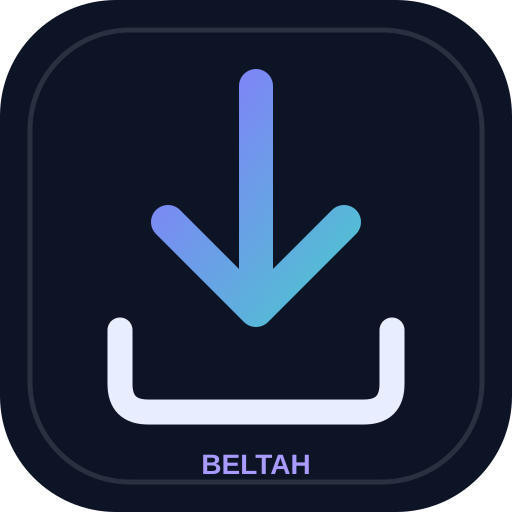

# BELTAH DOWNLOADER

<strong>Paste a link. Preview the media. Save the original file.</strong>

<a href="https://beltah-downloder.vercel.app">🌐 Open website</a> · <a href="https://github.com/Beltahtech1/Beltah-downloder">💻 Source repository</a>

## Product overview

BELTAH DOWNLOADER is a responsive direct-media workspace. Enter a direct media URL, identify the file type, preview supported audio/video in the browser, and open or save the original source file.

## Feature status

| Capability | Status | Notes |
|---|---|---|
| Direct HTTP(S) media URLs | ✅ Available | Source must expose a direct file URL and allow browser access |
| In-page video/audio playback | ✅ Available | Browser codec and source CORS/range support apply |
| File type and size hints | ✅ Best effort | Size is read from response headers when the source permits it |
| YouTube / Instagram / TikTok / X | ⏳ Not enabled | Platform pages are not direct files; authorised integration required |
| Format conversion | ⛔ Not available | The app previews/downloads original files; it does not transcode |
| PWA install | ✅ Available | Supported browsers can install the web app |

## Interface

- Custom BELTAH Downloader monogram and matching app icon.
- URL-first workflow with file-type filtering.
- Explicit provider availability labels and explanation for asterisked platforms.
- Loading skeletons, validation errors and playback state feedback.
- Administrator-only provider settings dialog.
- Responsive layout and reduced-motion support.

## Local development

Run a local static server from the project directory:

    python -m http.server 8000

Open http://localhost:8000.

## Vercel deployment

1. Import this repository into Vercel.
2. Use the **Other** framework preset and output directory `.`.
3. Add `ADMIN_PASSCODE` as a Vercel environment variable.
4. Redeploy after changing environment variables.

Never commit the administrator passcode or API secrets. Resolver values in the settings dialog are stored locally in the current browser and do not activate a backend provider by themselves.

## Custom domain

The production site currently uses the Vercel domain. To attach a branded domain, add a domain you own under **Vercel → Project → Settings → Domains**, then apply the DNS records Vercel provides. Advertise the custom URL only after DNS verification and HTTPS are active.

## Responsible use

Use the service only for media you own or are authorised to access. It does not bypass DRM, logins, paywalls, geographic restrictions or other platform controls.

---

BELTAH DOWNLOADER · BELTAH TECH TEAM

