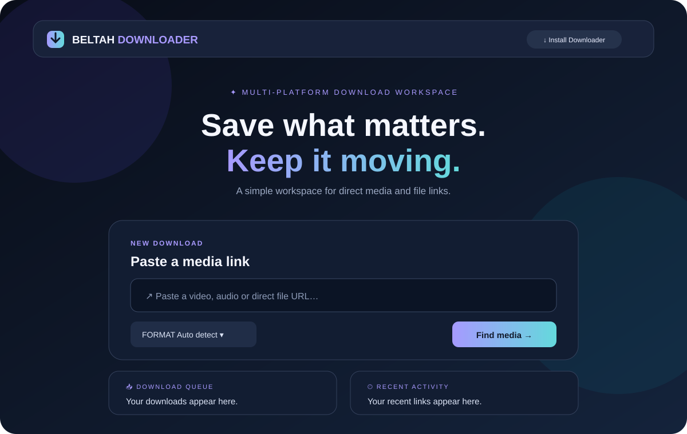

# BELTAH DOWNLOADER

<p align="center">
  <strong>⚡ A clean, responsive media-link workspace by Beltah Tech Team</strong><br>
  <a href="https://beltah-downloder.vercel.app">🌐 Open the website</a> ·
  <a href="https://github.com/Beltahtech1/Beltah-downloder">💻 GitHub repository</a>
</p>

<p align="center">
  
  
  
  
</p>

## 🖥️ Interface preview



> This is an illustrated preview of the current interface layout, not a screenshot captured from a live browser.

## ✨ Features

| Icon | Feature | Description |
|---|---|---|
| 🔗 | Link detection | Recognises common media platform domains and direct links. |
| 📥 | Direct file downloads | Supports direct HTTP(S) file URLs such as MP4, MP3, WebM, PDF, ZIP and images. |
| 🧾 | Recent history | Keeps a small list of recent links in the current browser. |
| 📋 | Download queue | Shows links/files prepared during the current session. |
| 📱 | Responsive layout | Designed for mobile screens, tablets and desktop browsers. |
| 🚀 | PWA installation | Install the web app on supported Android and desktop browsers. |
| ⚙️ | Admin settings | Passcode check is performed by a Vercel serverless endpoint; resolver settings are saved locally in the browser. |
| 🛡️ | Safer defaults | Accepts HTTP(S) URLs and does not attempt to bypass DRM or access restrictions. |

## 📌 Download support status

**Working now:** direct links that point to downloadable files. The remote host must allow the browser to fetch the file; cross-origin restrictions can affect some sources.

**Not enabled by default:** extracting media from YouTube, Instagram, TikTok, Facebook, X or other platform webpage links. Those pages are not direct media files. A compatible, documented and authorised resolver/backend must be integrated and tested before platform extraction can be advertised as working.

The project does not assume an undocumented API contract for `ytv.xcasper.space` or any public resolver. Use only content you own or have permission to download. Do not bypass DRM, access controls or platform restrictions.

## 🧰 Tech stack

- HTML5, CSS3 and vanilla JavaScript
- Web App Manifest + Service Worker
- Vercel static hosting and serverless function
- Browser localStorage for non-sensitive history and UI preferences

## 🚀 Deploy to Vercel

1. Import this repository into your Vercel account.
2. Choose **Other** as the framework preset.
3. Leave the build command empty.
4. Set the output directory to `.`.
5. Add `ADMIN_PASSCODE` under **Project → Settings → Environment Variables**.
6. Redeploy after saving the environment variable.

🔐 **Important:** choose a new, unique passcode and keep it only in Vercel Environment Variables. Never commit it to GitHub or paste it into client-side JavaScript.

## 📲 Install the app

- **Android / Chrome:** open the HTTPS website, then use the browser's **Install app** or **Add to Home Screen** option.
- **Desktop Chromium browsers:** use the install icon in the address bar or browser menu.
- **iPhone / iPad:** open the website in Safari → **Share** → **Add to Home Screen**.

The service worker caches the application shell. API routes are excluded from caching.

## ⚙️ Admin configuration notes

The admin panel checks the configured passcode through `/api/admin-auth`. Resolver URL and path values are saved only in that browser's local storage. They do not configure a server-side provider, store API secrets, or authorise privileged backend operations. A resolver must be implemented against its provider's documented request and response schema before it can be used.

## 🗂️ Project structure

```text
.
├── api/
│   └── admin-auth.js
├── docs/
│   └── preview.svg
├── icons/
│   └── icon.svg
├── app.js
├── index.html
├── manifest.json
├── styles.css
├── sw.js
├── vercel.json
└── README.md
```

## 🧪 Local preview

Run a local static server from the project directory, then open its localhost URL. For example:

```bash
python -m http.server 8000
```

Open `http://localhost:8000`. Service workers and PWA installation require localhost or HTTPS.

## 📦 Native installer status

This repository is a Progressive Web App. It does not currently contain genuine signed APK, EXE, MSI, DMG, AppImage or DEB installers. Do not rename text instructions as installer packages; publish real builds through GitHub Releases only when native packages have been produced and tested.

---

<p align="center">Made with 💜 by <strong>Beltah Tech Team</strong></p>
